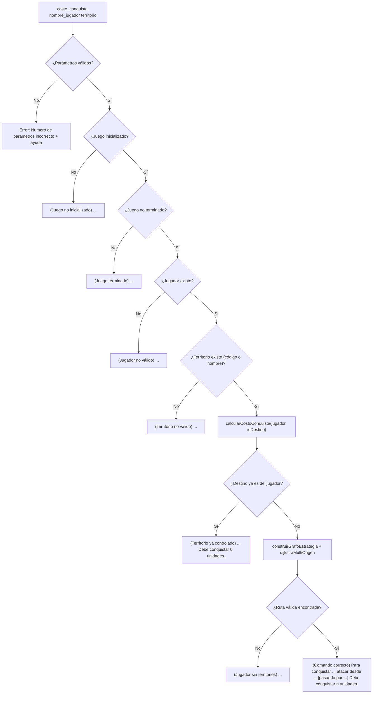

# Diseño Técnico y Verificación de Requisitos – Entrega 3 (Componente 3: Grafos)

**Proyecto:** Sistema de apoyo para el juego Risk  
**Asignatura:** Estructuras de Datos – Pontificia Universidad Javeriana  
**Rama:** `entrega_3`  
**Base:** Enunciado oficial (`enunciado proyecto EDD.pdf`, numerales 2.3, 2.4, 3, 3.4 y 3.5) + arquitectura actual del repositorio (`ListaLineal<T>`, C++98/11/17) + referencia estructural de `entrega_3_risk.zip`.

---

## 1. Verificación de Requisitos del Enunciado (Entrega 3 – Semana 17)

| Requisito del Enunciado | Numeral | Qué exige | Cómo se cumplirá en nuestra Entrega 3 |
|---|---|---|---|
| **Acta de evaluación de Entrega 2** | 3.4 (10 %) | Incluir al inicio del documento de diseño los comentarios literales/notas de Entrega 2 y las correcciones realizadas. | Registrar notas de Entrega 2 (`Diseño: 4.5`, `Implementación: 4.5`, `Pruebas: 4.5`), las mejoras de código ya aplicadas (eliminación de `std::vector` en TADs, traslado de filtros de vecinos a `Territorio`, actualización de `README.md` y `.gitignore`) y las correcciones de maquetación/evidencia del PDF. |
| **Documento de diseño incremental (PDF)** | 3.4 (25 %) | Entradas, salidas y condiciones del procedimiento principal y comandos; plantilla de clase para todos los TADs; esquemáticos de operaciones principales; 100 % coherente con el código. | Documento incremental que conserva Componentes 1 y 2 e incorpora el Componente 3: fichas y diagramas de flujo de `costo_conquista` y `conquista_mas_barata`, plantilla de clase de los nuevos TADs (`Arista`, `Vertice`, `Grafo`, `ResultadoConquista`), diagrama de relación actualizado y esquemático de un grafo ponderado real de una partida. |
| **Plan de pruebas de `costo_conquista`** | 3.4 (20 %) | Plan de pruebas siguiendo pautas de clase para `costo_conquista`, coherente con diseño y código. | Clases de equivalencia, valores límite y casos `C-01` a `C-14` (más pruebas de `conquista_mas_barata` y unitarias de `Grafo`), con salidas reales de consola y capturas UTF-8 limpias. |
| **Código fuente compilable (`gnu-g++ >= 4.0.0`)** | 3.4 (25 %) | Componentes 1, 2 y 3 integrados en un único ejecutable, compilable sin errores ni advertencias. | Código compatible con `-std=c++98`, `-std=c++11` y `-std=c++17` (`-Wall -Wextra`), sin `nullptr`, sin `auto` y sin `std::vector` en ningún TAD del dominio ni en `Grafo`. |
| **Comando `costo_conquista`** | 2.3 | `costo_conquista <nombre_jugador> <territorio>`: costo y secuencia de territorios desde el territorio propio más cercano al destino. | Grafo dirigido ponderado + Dijkstra multi-origen en TAD `Grafo`, invocado desde `JuegoRisk::calcularCostoConquista`. Salida exacta del enunciado. |
| **Comando `conquista_mas_barata`** | 2.3 | `conquista_mas_barata <nombre_jugador>`: entre todos los territorios posibles, el que implique menor pérdida de unidades. | Reutiliza el grafo ponderado + Dijkstra multi-origen desde `JuegoRisk::calcularConquistaMasBarata`. Salida exacta del enunciado. |
| **Interfaz unificada y `ayuda`** | 2.4 | Prompt `$ `, comando `ayuda` y `ayuda <comando>`, todos los componentes en un único programa. | Ya integrado en `src/main.cpp`; se actualiza la ayuda de `costo_conquista` y `conquista_mas_barata` si requiere precisión de uso. |
| **Empaquetado `.zip` estricto** | 3 | Único `.zip` sin carpetas internas, solo `.pdf` y fuentes `.h`, `.hxx`, `.cxx`, `.cpp`. | Incluirá `Proyecto_Risk_Entrega3.pdf` y los 23 archivos fuente (los 21 actuales + `Grafo.h` y `Grafo.cpp`). |
| **Declaración de uso de IA** | 3.5 | Comentarios en código/documento identificando aportes de IA y prompts utilizados. | Mantener marcas `[IA]` y Apéndice A actualizado con los prompts de Entrega 3. |

---

## 2. Adaptación respecto al Proyecto de Referencia (`entrega_3_risk.zip`)

El proyecto de referencia provee una solución sólida basada en **grafo dirigido ponderado + Dijkstra multi-origen**, pero presenta diferencias técnicas que debemos adaptar a nuestro código actual para conservar la calidad y evitar regresiones:

1. **Cero `std::vector` en TADs (100 % `ListaLineal<T>`):**
   - En la referencia, `Grafo` y `ResultadoConquista` usan `std::vector`.
   - En nuestro proyecto, todos los TADs (`TableroRisk`, `JuegoRisk`, `Territorio`, `Continente`, `Jugador`, `ColaPrioridad`) usan exclusivamente `ListaLineal<T>`. Por coherencia, **`Grafo` y `ResultadoConquista` usarán `ListaLineal<T>`** (para vértices, aristas, orígenes, distancias, saltos, predecesores y ruta reconstruida).
2. **Compatibilidad estricta con C++98 (`gnu-g++ >= 4.0.0`):**
   - La referencia usa `nullptr` (C++11) en `main.cpp`. En nuestro proyecto usaremos `NULL` y ciclos por índice para compilar sin advertencias en `-std=c++98`, `-std=c++11` y `-std=c++17`.
3. **Bug sutil evitado en el orden de validaciones de estado:**
   - En nuestro `JuegoRisk`, `estaInicializado()` devuelve `true` solo si `estadoJuego == ESTADO_EN_CURSO`. Si una partida termina (`ESTADO_TERMINADO`), verificar `!juego.estaInicializado()` antes de `juego.estaTerminado()` imprimiría erróneamente `(Juego no inicializado)` en lugar de `(Juego terminado)`.
   - Por eso, en `costo_conquista` y `conquista_mas_barata` evaluaremos **primero `juego.estaTerminado()`** (o mantendremos `is_initialized` como en el resto de `main.cpp`, donde `!is_initialized` solo es cierto antes de `inicializar`, y luego `juego.estaTerminado()`).
4. **Sobrecarga `const` en `JuegoRisk::buscarJugadorPorNombre`:**
   - Agregaremos `const Jugador* buscarJugadorPorNombre(const std::string& nombreBuscado) const;` para que `calcularCostoConquista` y `calcularConquistaMasBarata` sean operaciones puras de consulta (`const`) que garantizan no alterar el estado del juego.
5. **Búsqueda flexible de territorio (`obtenerTerritorioPorIdONombre`):**
   - Adoptaremos de la referencia `TableroRisk::obtenerTerritorioPorIdONombre(...)` (acepta código oficial `"5.6"` o nombre `"Kamchatka"` / `"Gran Bretana"` / `"América Central"`, normalizando mayúsculas y tildes UTF-8), porque el enunciado muestra `<territorio>` sin restringir si el usuario escribe código o nombre.

---

## 3. Modelado Matemático del Grafo de Estrategia

Para un jugador $J$ (con color $c_J$) en una partida en curso, el tablero de Risk se modela como un **grafo dirigido y ponderado** $G_J = (V, E, w)$:

- **Vértices ($V$):** Los 42 territorios del tablero, indexados $0 \dots 41$ en el orden oficial de `TableroRisk::listaTerritoriosGlob`. Cada vértice guarda su código `id` (`"1.1"` a `"6.4"`) y su lista de adyacencia `adyacentes`.
- **Aristas dirigidas ($E$):** Por cada frontera oficial $(u, v)$ del tablero se crean dos aristas dirigidas $u \to v$ y $v \to u$.
- **Función de peso ($w: E \to \mathbb{Z}_{\ge 0}$):**
  $$w(u \to v) = \begin{cases} 0 & \text{si } \text{color}(v) = c_J \text{ (territorio propio)} \\ \text{tropas}(v) & \text{si } \text{color}(v) \neq c_J \text{ (territorio enemigo)} \end{cases}$$
- **Conjunto de orígenes ($S \subseteq V$):** Todos los territorios ocupados actualmente por el jugador $J$.
- **Algoritmo (Dijkstra multi-origen):**
  - Se inicializan $dist[s] = 0$, $saltos[s] = 0$, $pred[s] = -1$ para todo $s \in S$; y $dist[v] = \infty$, $saltos[v] = \infty$, $pred[v] = -1$ para todo $v \notin S$.
  - En cada iteración se escoge el vértice no visitado $u$ con menor par lexicográfico $(dist[u], saltos[u])$.
  - Al relajar cada arista $(u \to v)$ con peso $w(u \to v)$: si $(dist[u] + w(u \to v), saltos[u] + 1) < (dist[v], saltos[v])$, se actualizan $dist[v]$, $saltos[v]$ y $pred[v] = u$.
  - **Propiedad garantizada:** Como todo $s \in S$ inicia con $(0, 0)$ y todo $w \ge 0$, ningún vértice propio es relajado por otro camino; por tanto, toda ruta reconstruida `[ruta[0], ruta[1], ..., ruta[m]]` parte siempre de un **territorio propio** (`ruta[0]`, el origen más cercano al destino) y atraviesa únicamente **territorios enemigos** (`ruta[1..m]`), acumulando en $dist[d]$ la suma exacta de unidades enemigas a conquistar.
  - **Complejidad:** Con $V = 42$ y $E \approx 166$ aristas dirigidas, la implementación $O(V^2 + E)$ sobre `ListaLineal` realiza menos de 2 000 operaciones por consulta (instantánea) y no requiere estructuras auxiliares complejas.

---

## 4. Diseño de los Nuevos TADs (Plantilla de Clase)

### 4.1. TAD `Arista` (en `tads/Grafo.h`)

**Datos mínimos**

| Dato | Tipo | Representa |
|---|---|---|
| `indiceDestino` | entero | Posición del vértice destino dentro de la lista de vértices del grafo. |
| `peso` | entero | Costo (en unidades de ejército) de cruzar la arista hacia el destino ($\ge 0$). |

**Operaciones**

| Operación | Entradas | Salida | Descripción |
|---|---|---|---|
| `CrearArista(dest, peso)` | dos enteros (opcionales) | Arista | Crea una arista hacia `dest` con peso `peso` (por defecto `-1` y `0`). |
| `obtenerDestino()` | — | entero | Retorna el índice del vértice destino. |
| `obtenerPeso()` | — | entero | Retorna el peso de la arista. |
| `fijarDestino(dest)` | entero | — | Actualiza el índice destino. |
| `fijarPeso(peso)` | entero | — | Actualiza el peso de la arista. |

---

### 4.2. TAD `Vertice` (en `tads/Grafo.h`)

**Datos mínimos**

| Dato | Tipo | Representa |
|---|---|---|
| `id` | cadena de caracteres | Código oficial del territorio (ej. `"1.1"`, `"5.6"`). |
| `adyacentes` | lista de `Arista` (`ListaLineal<Arista>`) | Aristas salientes desde este vértice. |

**Operaciones**

| Operación | Entradas | Salida | Descripción |
|---|---|---|---|
| `CrearVertice(id)` | cadena (opcional) | Vertice | Crea un vértice con el identificador dado y sin aristas salientes. |
| `obtenerId()` | — | cadena | Retorna el identificador del vértice. |
| `obtenerAdyacentes()` | — | referencia constante a lista de `Arista` | Retorna la lista de aristas salientes. |
| `fijarId(id)` | cadena | — | Actualiza el identificador del vértice. |

---

### 4.3. TAD `Grafo` (en `tads/Grafo.h` y `tads/Grafo.cpp`)

**Datos mínimos**

| Dato | Tipo | Representa |
|---|---|---|
| `vertices` | lista de `Vertice` (`ListaLineal<Vertice>`) | Colección de vértices del grafo dirigido y ponderado. |

**Operaciones**

| Operación | Entradas | Salida | Descripción |
|---|---|---|---|
| `CrearGrafo()` | — | Grafo | Crea un grafo vacío. |
| `limpiar()` | — | — | Elimina todos los vértices y sus aristas. $O(V + E)$. |
| `estaVacio()` | — | booleano | Indica si el grafo no tiene vértices. $O(1)$. |
| `cantidadVertices()` | — | entero | Retorna la cantidad de vértices del grafo. $O(1)$. |
| `buscarVertice(id)` | cadena | entero | Busca un vértice por `id` y retorna su índice (o `-1` si no existe). $O(V)$. |
| `agregarVertice(id)` | cadena | entero | Inserta el vértice si no existe y retorna su índice. $O(V)$. |
| `obtenerIdVertice(indice)` | entero | cadena | Retorna el `id` del vértice en `indice` (o `""` si está fuera de rango). |
| `agregarArista(idOrigen, idDestino, peso)` | dos cadenas, entero | booleano | Agrega una arista dirigida buscando los vértices por `id`. |
| `agregarAristaPorIndice(idxOrigen, idxDestino, peso)` | tres enteros | booleano | Agrega una arista dirigida si ambos índices son válidos y `peso >= 0`. |
| `dijkstraMultiOrigen(origenes, distancias, saltos, predecesores)` | lista de enteros (entrada); tres listas de enteros (salida) | booleano | Ejecuta Dijkstra desde múltiples orígenes (costo 0) y llena distancias mínimas, saltos y predecesores. Retorna falso si el grafo está vacío o sin orígenes válidos. |
| `reconstruirCamino(idxDestino, predecesores, ruta)` | entero, lista de enteros, lista de cadenas (salida) | — | Reconstruye en `ruta` la secuencia de códigos `[origen, ..., destino]` siguiendo `predecesores`. |

---

### 4.4. TAD `ResultadoConquista` (en `tads/JuegoRisk.h`)

**Datos mínimos**

| Dato | Tipo | Representa |
|---|---|---|
| `valido` | booleano | Indica si se encontró una ruta de conquista válida (o territorio ya controlado). |
| `yaControlado` | booleano | Indica si el territorio destino ya pertenece al jugador consultado. |
| `costoUnidades` | entero | Suma de unidades enemigas a conquistar en el camino óptimo. |
| `codigoOrigen` | cadena | Código del territorio propio desde donde se inicia el ataque. |
| `codigoDestino` | cadena | Código del territorio objetivo a conquistar. |
| `rutaCodigos` | lista de cadenas (`ListaLineal<std::string>`) | Secuencia completa de códigos `[origen, intermedios..., destino]`. |

**Operaciones**

| Operación | Entradas | Salida | Descripción |
|---|---|---|---|
| `CrearResultadoConquista()` | — | ResultadoConquista | Inicializa `valido` y `yaControlado` en falso, costo en 0 y cadenas vacías. |
| `esValido()` / `estaYaControlado()` | — | booleano | Consultas de estado del resultado. |
| `obtenerCostoUnidades()` | — | entero | Retorna el costo total en unidades. |
| `obtenerCodigoOrigen()` / `obtenerCodigoDestino()` | — | cadena | Retornan los códigos de origen y destino. |
| `obtenerRutaCodigos()` | — | referencia constante a lista de cadenas | Retorna la secuencia completa de códigos de la ruta. |

---

### 4.5. Extensiones a TADs Existentes

- **`TableroRisk`**:
  - `obtenerTerritorioPorIdONombre(texto)` (versiones mutable y `const`): busca primero coincidencia exacta por `idTerritorio` y, si no existe, compara `nombreTerritorio` normalizado (minúsculas y sin tildes/eñe UTF-8).
- **`JuegoRisk`**:
  - `buscarJugadorPorNombre(nombre) const`: sobrecarga constante para consultas de estrategia.
  - `construirGrafoEstrategia(colorJugador, grafo, origenes) const`: construye el grafo dirigido ponderado con los 42 territorios y llena `origenes` con los índices de los territorios del jugador.
  - `calcularCostoConquista(nombreJugador, idTerritorioDestino) const`: retorna `ResultadoConquista` para el comando `costo_conquista`.
  - `calcularConquistaMasBarata(nombreJugador) const`: retorna `ResultadoConquista` para el comando `conquista_mas_barata`.

---

## 5. Fichas y Esquemáticos de los Comandos del Componente 3

### 5.1. Ficha del comando `costo_conquista`

- **Uso:** `costo_conquista <nombre_jugador> <territorio>`
- **Entradas:** `nombre_jugador` (cadena sin espacios) y `territorio` (código oficial como `5.6` o nombre del territorio, incluso con espacios como `America Central`).
- **Condiciones (en orden de evaluación):**
  1. Se reciben 2 parámetros (o más de 2 solo si los argumentos desde el segundo en adelante forman un nombre de territorio válido cuando el juego está inicializado).
  2. El juego ha sido inicializado.
  3. El juego no ha terminado.
  4. `nombre_jugador` existe en la partida.
  5. `territorio` existe en el tablero (por código o nombre).
  6. El jugador controla al menos 1 territorio desde el cual atacar.
  7. Si el territorio ya es del jugador, se informa que ya lo controla con costo 0; si es enemigo, se calcula el camino mínimo con Dijkstra multi-origen.
- **Salidas:**
  - Éxito (con intermedios): `(Comando correcto) Para conquistar el territorio <dest>, <nombre_jugador> debe atacar desde <orig>, pasando por los territorios <t2>, ..., <tm>. Debe conquistar <n> unidades de ejército.`
  - Éxito (vecino directo): `(Comando correcto) Para conquistar el territorio <dest>, <nombre_jugador> debe atacar desde <orig>. Debe conquistar <n> unidades de ejército.`
  - Ya controlado: `(Territorio ya controlado) El jugador <nombre_jugador> ya controla el territorio <dest>. Debe conquistar 0 unidades de ejército.`
  - Errores: `Error: Numero de parametros incorrecto.` + ayuda; `(Juego no inicializado) ...`; `(Juego terminado) ...`; `(Jugador no válido) ...`; `(Territorio no válido) ...`; `(Jugador sin territorios) ...`.
- **Efecto:** Ninguno sobre el estado de la partida (solo consulta).
- **TADs:** `JuegoRisk::calcularCostoConquista`, `JuegoRisk::construirGrafoEstrategia`, `TableroRisk::obtenerTerritorioPorIdONombre`, `Grafo` (`agregarVertice`, `agregarAristaPorIndice`, `dijkstraMultiOrigen`, `reconstruirCamino`), `ResultadoConquista`.

### 5.2. Ficha del comando `conquista_mas_barata`

- **Uso:** `conquista_mas_barata <nombre_jugador>`
- **Entradas:** `nombre_jugador`.
- **Condiciones (en orden de evaluación):**
  1. Exactamente 1 parámetro.
  2. El juego está inicializado.
  3. El juego no ha terminado.
  4. `nombre_jugador` existe en la partida.
  5. Existe al menos un territorio enemigo alcanzable desde los territorios del jugador.
- **Salidas:**
  - Éxito: `(Comando correcto) La conquista más barata es avanzar sobre el territorio <dest> desde el territorio <orig>. Para conquistar el territorio <dest>, debe atacar desde <orig>[, pasando por los territorios <t3>, ..., <tm>]. Debe conquistar <n> unidades de ejército.`
  - Errores: `Error: Numero de parametros incorrecto.` + ayuda; `(Juego no inicializado) ...`; `(Juego terminado) ...`; `(Jugador no válido) ...`; `(Jugador sin territorios) ...`.
- **Efecto:** Ninguno sobre el estado de la partida (solo consulta).
- **TADs:** `JuegoRisk::calcularConquistaMasBarata`, `JuegoRisk::construirGrafoEstrategia`, `Grafo`, `ResultadoConquista`.

---

## 6. Plan de Pruebas Diseñado para `costo_conquista` (Numeral 3.4)

### Clases de equivalencia
- **Estado del juego:** Válida (`EN_CURSO`) | Inválidas (`NO_INICIALIZADO`, `TERMINADO`).
- **Parámetros:** Válida (2 tokens o nombre de territorio con espacios válido) | Inválidas (0, 1 o sobrantes que no formen territorio).
- **Jugador:** Válida (jugador con $\ge 1$ territorio, en turno o fuera de turno) | Inválidas (no existe, eliminado con 0 territorios).
- **Territorio destino:** Válida (enemigo vecino directo, enemigo a múltiples saltos, por código o por nombre con/sin tildes/espacios) | Inválidas (código inexistente, nombre inexistente, territorio ya controlado por el jugador).

### Casos de prueba planificados (`C-01` a `C-14`)
- **C-01:** `costo_conquista Juan 5.6` sin inicializar -> `(Juego no inicializado)`.
- **C-02:** `costo_conquista` (0 parámetros) y `costo_conquista Juan` (1 parámetro) -> `Error: Numero de parametros incorrecto.` + ayuda.
- **C-03:** `costo_conquista Juan 5.6 extra` (sobran parámetros) -> `Error: Numero de parametros incorrecto.` + ayuda.
- **C-04:** `costo_conquista Pepe 5.6` (jugador inexistente) -> `(Jugador no válido)`.
- **C-05:** `costo_conquista Juan 9.9` (territorio inexistente) -> `(Territorio no válido)`.
- **C-06:** `costo_conquista Juan 1.1` (territorio ya controlado por Juan) -> `(Territorio ya controlado)` con costo 0.
- **C-07:** `costo_conquista Juan 5.6` (vecino directo: `1.1 Alaska -> 5.6 Kamchatka`, sin intermedios) -> costo 3, sin cláusula `pasando por`.
- **C-08:** `costo_conquista Juan Kamchatka` (búsqueda por nombre en lugar de código) -> mismo resultado que C-07.
- **C-09:** `costo_conquista Pedro America Central` (nombre con espacios y sin tilde, consulta válida para jugador que no está en turno) -> ruta óptima desde territorio más cercano de Pedro.
- **C-10:** `costo_conquista Juan 6.1` (Australia Oriental, ruta de múltiples saltos intercontinentales) -> verifica suma exacta de unidades enemigas en la ruta óptima y lista ordenada de territorios intermedios.
- **C-11:** Empate de costo entre dos rutas -> verifica desempate por menor cantidad de saltos (menos territorios intermedios).
- **C-12:** Consulta tras modificar tropas en el tablero (ej. reforzar un territorio que bloqueaba la ruta anterior) -> la ruta óptima se recalcula dinámicamente y elige el nuevo camino más barato.
- **C-13:** Jugador eliminado (0 territorios, cargado desde `.bin`) -> `(Jugador sin territorios)`.
- **C-14:** Juego terminado (42 territorios conquistados) -> `(Juego terminado)`.
- **Complementarios (`M-01` a `M-06`):** Validación de `conquista_mas_barata` (sin inicializar, parámetros, jugador inválido, caso normal con `archivo_inicio.txt`, desempate por saltos y tras cambio de tropas) + pruebas unitarias del TAD `Grafo`.
